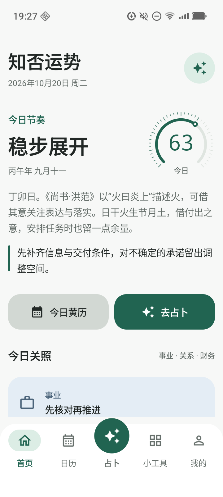
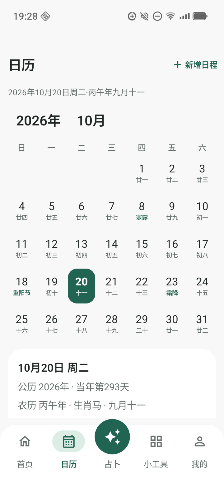
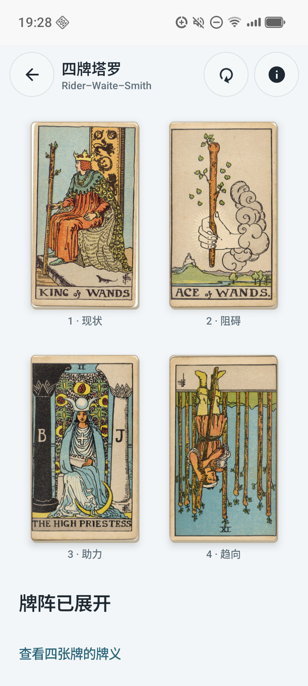
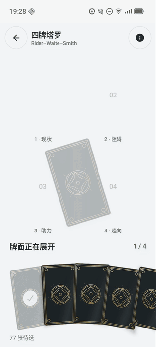
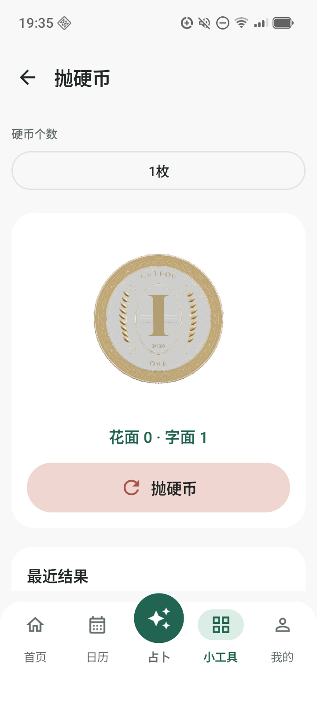
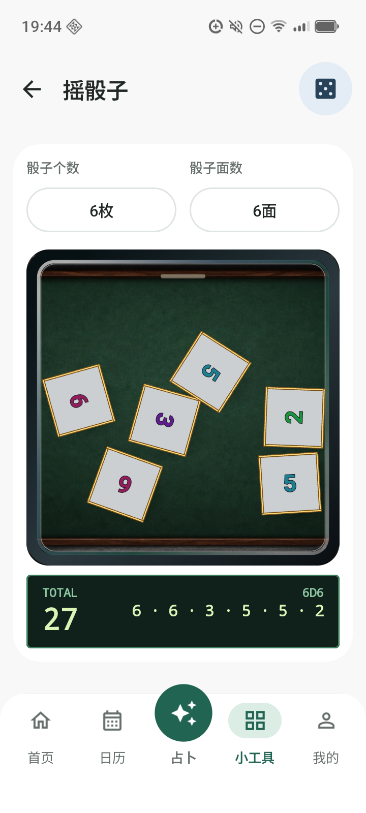

# 实机演示 / Device Showcase

[下载 APK](https://github.com/moka992/zhifou-fortune/releases/latest) · [English](#english) · [拍摄方式](#拍摄与隐私)

以下录屏来自 v1.1.0，作为实机演示保留。当前下载版本及塔罗交互修正见 [v1.1.1](releases/v1.1.1.md)。 / These recordings remain v1.1.0 captures; see [v1.1.1](releases/v1.1.1.md) for the current build and tarot interaction updates.

## 界面

  
  
  

这三张图分别展示首页、日历和四牌塔罗的实际界面。不是概念设计，也没有用图片生成工具重新绘制 UI。Android 界面主要为简体中文；应用中的资料与日程不需要注册账号即可保存在设备本地。

## 手动选牌与翻面

[观看完整四牌抽取视频（MP4）](https://github.com/moka992/zhifou-fortune/releases/download/v1.1.0/zhifou-fortune-v1.1.0-tarot-demo.mp4)

四牌塔罗使用完整 78 张韦特牌组，支持正逆位、可选提问与逐张手动选取。基础结果和牌义离线可用，AI 解读单独按需使用。这个现代四牌十字布局的来源、规则与限制见[玩法说明](four-card-tarot.md)。

## 3D 小工具

  
  

[观看抛硬币（MP4）](https://github.com/moka992/zhifou-fortune/releases/download/v1.1.0/zhifou-fortune-v1.1.0-coin-demo.mp4) · [观看六枚骰子（MP4）](https://github.com/moka992/zhifou-fortune/releases/download/v1.1.0/zhifou-fortune-v1.1.0-dice-demo.mp4)

视频展示实际运行的模型和动画。截图不能表达旋转过程，也无法传递马达触感；触觉效果仍应拿起兼容手机体验。骰子支持 1–6 枚 D4、D6、D8、D10、D12、D20，硬币支持 1–10 枚。设备帧率与马达表现不作跨设备一致性承诺。

## 如何试用

1. 从 [GitHub Releases](https://github.com/moka992/zhifou-fortune/releases/latest) 下载 `arm64-v8a` APK，使用 Android 8.0 及以上设备安装。
2. 无需 Key 即可使用基础占卜、日历、日程和小工具；AI 解读与云端语音为可选功能。
3. 当前仍为调试签名体验包，不是生产商店包；旧安装签名一致时可覆盖更新，不要先卸载以免丢失本地资料。
4. 反馈时说明复现步骤、系统版本和相关屏幕尺寸。不提交 API Key、真实占卜问题、个人资料或未脱敏截图。

没有安卓设备时，可以在电脑上运行[独立 Skill 的本地演示](https://github.com/moka992/zhifou-oracle-skills#try-it-in-a-minute)。它展示相同基础中的抽取、资料查找与校验，不是安卓 UI 模拟器，也不会自行生成 AI 解读。

## 拍摄与隐私

画面拍摄自物理安卓设备上的 v1.1.0 界面代码。仅供 ADB 使用的 [ShowcaseActivity](../app/src/debug/java/com/zhifou/fortune/ShowcaseActivity.kt) 复用真实界面，通过独立的空白 SharedPreferences 和缓存目录隔离现有账户。演示不填写个人资料、私密问题或服务密钥，也未调用 AI。

[录制脚本](../tools/capture_showcase.py) 在捕获前检查展示页是否处于前台，并检查投掷动作确实产生结果。截图不重绘；GIF 只对实录做片段裁取、缩放与编码，视频移除容器附加元数据。发布前逐张检查截图，并抽帧核查视频；不是凭文件名就假定截图已脱敏。

拍摄活动只存在于 debug 源集，并由 Android 的 `DUMP` 权限保护。本轮文档与展示工具更新不替换既有 v1.1.0 APK，不改变正式功能、规则或源码授权。

## English

These are **actual physical-device captures**, not proposed UI mockups. The overview, offline Gregorian/lunar calendar, manual four-card tarot, original double-sided coins and multi-die simulation are rendered by the application's real components.

- [Full manual tarot draw](https://github.com/moka992/zhifou-fortune/releases/download/v1.1.0/zhifou-fortune-v1.1.0-tarot-demo.mp4)
- [3D coin toss](https://github.com/moka992/zhifou-fortune/releases/download/v1.1.0/zhifou-fortune-v1.1.0-coin-demo.mp4)
- [Six-die roll](https://github.com/moka992/zhifou-fortune/releases/download/v1.1.0/zhifou-fortune-v1.1.0-dice-demo.mp4)
- [Download Android evaluation APK](https://github.com/moka992/zhifou-fortune/releases/latest)
- [Try the independent no-key skill demo on your computer](https://github.com/moka992/zhifou-oracle-skills#try-it-in-a-minute)

The Android UI is primarily Simplified Chinese. Core readings and tools work without an account or API key. Optional AI interpretation uses the user's own provider; that provider or host may charge. The application source is public for inspection but is **not granted an open-source license**. The independent skill has its own licensing terms.

The recordings use the v1.1.0 interface with a debug-only, permission-protected showcase activity and separate blank preferences/cache. No real profile, private question or credential was used. Stills are not repainted; the GIF is a trimmed/resized real recording, and video container metadata is stripped. These clips have no audio and cannot demonstrate physical haptics or guarantee frame rate on other devices.

This presentation update does not replace the published v1.1.0 APK. It remains a debug-signed evaluation build for Android 8.0+ / `arm64-v8a`. Matching-signature installations can update in place; uninstalling first removes local data. Check [release notes](releases/v1.1.0.md) and [privacy/source information](../README.md#permissions-and-privacy) before use.
